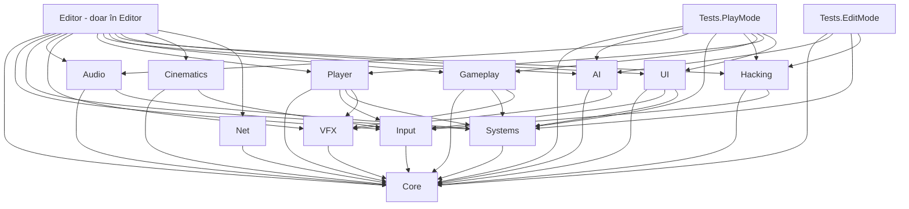

# Arhitectura Root Access

Documentul descrie cum e organizat codul, cum comunică sistemele și cum se salvează jocul. Deciziile specifice Unity
sunt explicate pe scurt, pentru cine vine din web sau backend.

## 1. Principii

- **Model separat de prezentare.** Logica de joc stă în clase C# simple, fără `MonoBehaviour`: `Inventory`,
  `TraceMeter`, `QuestLog`, `SkillTree`, `Wallet`, `AStarPathfinder`, modelele de hacking. Componentele Unity sunt
  „view-uri” subțiri peste ele. Logica se testează astfel în EditMode, fără scene, și se poate oglindi mai târziu în
  `NetworkVariable` pentru co-op.
- **Comunicare decuplată.** Sistemele nu se caută unele pe altele cu `Find*`. Folosim trei mecanisme:
  1. `EventBus<T>`: publish/subscribe static și tipizat, cu payload `struct` (fără alocări la publicare);
  2. `ServiceLocator`: registru pentru serviciile de lungă durată (GameManager, SceneLoader, AudioManager, PoolService,
     SessionService, IPlayerTarget);
  3. referințe serializate (`[SerializeField] private`), setate de generatoarele din Editor.
- **Conținut generat din cod.** Scenele, prefab-urile, materialele, mixerul și animatorii sunt create de scripturi de
  Editor rulate în batchmode, nu de mână. Așa build-ul e reproductibil, iar diff-urile importante rămân în C#.
- **Fără valori „magice”.** Layere, tag-uri, ID-uri de scene, parametri de mixer și ID-uri de SFX/VFX stau în
  `Core/Constants.cs` și `Core/Ids.cs`. Tot textul afișat jucătorului e în `Core/Strings.cs` (interfața) și în
  `Editor/Generation/SeedContent.cs` (conținutul scris în asset-uri), în română și engleză (vezi secțiunea despre limbă).

## 2. Module și assembly definitions

Fiecare folder din `Assets/_Project/Scripts` are propriul `.asmdef`, adică un assembly .NET separat. Unity recompilează
doar ce s-a schimbat, iar dependențele sunt explicite: un ciclu sau o referință interzisă dă eroare de compilare.



| Assembly | Responsabilitate | Pachete externe |
|---|---|---|
| `Core` | EventBus, ServiceLocator, FSM generic, PoolService, SaveSystem, SettingsService, SceneLoader, GameManager, contracte (`IDamageable`, `IInteractable`, `IHackable`, `IPlayerTarget`…), constante, `Strings` | — |
| `Input` | asset-ul `.inputactions`, wrapper-ul C# generat, `InputReader` (ScriptableObject cu evenimente), `RebindService`, `InputModeController` | Input System |
| `Systems` | Inventory, TraceMeter, Wallet, SkillTree, QuestLog, Dialogue, `GameSession` + `SaveData`, `SessionService`, `GameDatabase` | — |
| `VFX` | VfxSpawner (pool), ScreenShake (Cinemachine impulse), CameraController, FlickerLight2D, DissolveController, Parallax, FoliageWind, SkyboxBackdrop | URP 2D, Cinemachine |
| `Audio` | AudioManager (surse în pool), MusicDirector (stealth ↔ alertă), MixerSnapshots, FootstepPlayer, SfxLibrary | — |
| `AI` | A* (`AStarGrid`, `AStarPathfinder`, `PathfindingGrid`, `PathRequestQueue`), VisionCone, Guard (FSM), SecurityCamera, Drone, Turret | URP 2D |
| `Player` | PlayerController (FSM cu 9 stări), PlayerSensors, PlayerHealth, PlayerInteractor, PlayerVisibility, AnimatorBridge | Input System |
| `Gameplay` | Terminal, Door, Elevator, NetworkNode/TeleportPad, Pickup, Hazard, Checkpoint, LevelExit, HideZone, WaterBody2D, WindZone2D, AlarmZone, LevelContext, terminalele din Hub | URP 2D, TMP |
| `Hacking` | modelele PatternMemory / WireConnect / PortScan, view-urile lor, `HackingOverlay` | UGUI, TMP |
| `UI` | meniuri, setări, pauză, HUD, game over, nivel complet, loading, inventar, skill tree, jurnal de misiuni, dialog, panoul de barem F1 | UGUI, TMP |
| `Cinematics` | CutsceneController, SkipCutscene, receptori de semnale Timeline | Timeline, Cinemachine |
| `Net` | `CoopSession` (co-op local + LAN), `NetworkOperatorLink` | Core, Input, Systems, Netcode for GameObjects, Unity Transport |
| `Editor` | ProjectSetup, PlaceholderArtGenerator, SceneBuilder + fabrici, BuildScript, RubricValidator | pachete de Editor |

Regulă: `Core` nu depinde de nimic. Un modul de gameplay nu referă alt modul de gameplay (`Player` nu vede `AI`, `AI` nu
vede `Player`). Când două module trebuie să comunice, folosesc contractele din `Core` și evenimentele de pe bus. Exemplu:
drona urmărește un `IPlayerTarget` luat din ServiceLocator, nu un `PlayerController`.

## 3. Ciclul de viață și scenele

```
Bootstrap (build index 0) ──► MainMenu ──► Hub ──► Level01_Rooftops ──► …
          ▲
 [RuntimeInitializeOnLoadMethod(BeforeSceneLoad)] SystemsBootstrapper
 instanțiază o singură dată Resources/SystemsRoot (DontDestroyOnLoad):
 GameManager, SceneLoader, SessionService, AudioManager, MusicDirector, MixerSnapshots,
 PoolService, VfxSpawner, ScreenShake, UIRoot (HUD, meniuri, overlay de hacking, loading, panou F1)
```

- `SystemsRoot` apare înaintea primei scene. De aceea orice scenă poate fi pornită direct în Editor.
- `GameManager` ține starea de nivel înalt (`Boot`, `MainMenu`, `Loading`, `Playing`, `Paused`, `Hacking`, `Dialogue`,
  `GameOver`, `LevelComplete`, `Terminal`), setează `Time.timeScale` și publică `GameStateChanged`. UI-ul reacționează la
  acest eveniment. `Terminal` e starea terminalului personal (inventar, abilități, magazin): timpul e oprit, input-ul e pe UI.
- `SceneLoader` încarcă asincron cu `allowSceneActivation = false` până trece durata minimă a ecranului de încărcare
  (progresul vine prin `SceneLoadProgress`), apoi publică `SceneLoadCompleted`.
- `LevelContext` (execution order −200) plasează jucătorul: întâi la spawn-ul cerut (fast travel, panoul F1, `-ra-spawn`),
  altfel la ultimul checkpoint, altfel la spawn-ul implicit.

## 4. Fluxul de evenimente

Toate evenimentele sunt `readonly struct : IEvent`, definite în `Core/Events/*.cs` și `Systems/SystemEvents.cs`.

| Domeniu | Evenimente |
|---|---|
| Scene / stare | `SceneLoadStarted`, `SceneLoadProgress`, `SceneLoadCompleted`, `GameStateChanged`, `SettingsChanged`, `LanguageChanged`, `LevelCompleted` |
| Jucător | `PlayerHealthChanged`, `PlayerDied`, `PlayerRespawnRequested`, `PlayerRespawned`, `PlayerHiddenChanged`, `CheckpointReached`, `InteractionPromptChanged` |
| Stealth | `TraceNoise`, `TraceChanged`, `TraceLevelChanged`, `AlarmRaised`, `PlayerNoise` |
| Hacking | `HackRequested`, `HackSessionStarted`, `HackResolved`, `HackSessionEnded` |
| Progres | `ObjectiveReported`, `QuestChanged`, `InventoryChanged`, `CreditsChanged`, `XpChanged`, `SkillUnlockedEvent`, `ToastRequested`, `TerminalScreenRequested` |
| Dialog | `DialogueRequested`, `DialogueLineShown`, `DialogueEnded` |
| Prezentare | `SfxRequested`, `FootstepRequested`, `VfxRequested`, `ScreenShakeRequested`, `MusicMoodRequested`, `UnderwaterChanged`, `CameraZoneEntered`, `TeleportStarted`, `TeleportCompleted` |

Exemplu, hack-ul unei uși:

```
PlayerInteractor (E) ─► Terminal.Interact ─► HackRequested(id, minigame, dificultate)
HackingOverlay ─► HackSessionStarted ─► GameManager: Playing→Hacking · PlayerController: stare Hack · CameraController: zoom
   minigame terminat ─► HackResolved(id, succes) + HackSessionEnded
Terminal (succes) ─► IHackable.ApplyHack(Open) pe Door ─► animator + SFX
                 ─► ObjectiveReported(Hack, terminalId) ─► SessionService ─► QuestLog.Report ─► QuestChanged ─► HUD
                 ─► Wallet.Add / SkillTree.AddXp ─► CreditsChanged ─► HUD
Terminal (eșec)  ─► TraceNoise(+15) ─► SessionService ─► TraceMeter ─► TraceChanged/TraceLevelChanged ─► HUD, MusicDirector, MixerSnapshots
```

Exemplu, detecția: `VisionCone.CanSee` (raycast) ─► `Guard` intră în Suspicious/Chase, iar camerele, dronele și
zonele de alarmă publică `TraceNoise` (camerele și `AlarmZone` publică și `AlarmRaised`). `SessionService` trimite
zgomotul în `TraceMeter`, care trece pragurile 25 / 60 / 100 și publică `TraceLevelChanged`. La acest eveniment
reacționează `MusicDirector` (muzica de alertă), `MixerSnapshots` (snapshot-ul `Alarm`) și HUD-ul (la 100 afișează
„BLOCARE TOTALĂ”). Gardienii aflați la cel mult `GuardConfig.alarmResponseRadius` de un `AlarmRaised` intră în Search
la poziția alarmei.

Exemplu, auzul: pașii jucătorului (`FootstepPlayer.noiseRadius` × volum × suprafață; abilitatea „Pași silențioși” dă
volum 0,3, iar mersul ghemuit nu are evenimente de pas), aterizările dure (`PlayerController`, 4–9 u) și exploziile EMP
publică `PlayerNoise(poziție, rază)`. Fiecare `Guard` aplică regula pură `Hearing.CanHear` (un zid între sursă și gardian
lasă să treacă 45% din rază) și trece în starea Investigate: merge la sursă, se uită în ambele părți, apoi revine la rută.

Exemplu, progresia: `LevelExit` raportează `ObjectiveReported(Reach, exitId)`, deblochează `unlocksLevel` și salvează.
`QuestLog.TryComplete` pornește automat `QuestDefinition.followUpQuest` (misiunea principală a nivelului următor), iar
consola de călătorie din Hub deschide tab-ul `TerminalTab.Travel` cu nivelurile 1–6 (cele blocate sau încă neconstruite
nu pot fi alese).

Exemplu, magazinul din Hub: `ShopTerminal.Interact` ─► `TerminalScreenRequested(Shop, oferte)` ─► `TerminalScreenView.Open`
─► `GameManager.EnterTerminal` (timp oprit) ─► „Cumpără” ─► `SessionService.Buy` ─► `Shop.TryBuy(Wallet, Inventory, ofertă)`
─► `CreditsChanged` + `InventoryChanged` ─► HUD și lista se reîmprospătează.

Efectele skill-urilor nu sunt centralizate: fiecare consumator întreabă `SessionService.HasSkillEffect(...)` acolo unde
contează (dash, viață maximă, rază de interacțiune, dificultatea terminalelor, volumul pașilor, creșterea urmăririi,
raza EMP). Hacking-ul nu depinde de Systems, așa că efectele de spargere sunt aplicate de `Terminal` (Gameplay).

## 5. Jucătorul și AI-ul

- **PlayerController**: `Rigidbody2D` dinamic plus un FSM cu stări-obiect (Grounded, Airborne, WallSlide, Dash, Swim,
  Hack, Hurt, Dead, Teleport). Input-ul e bufferizat în controller (jump buffer, coyote time, dash buffer). Toate
  valorile reglabile stau în asset-ul `PlayerMovementConfig`. `PlayerSensors` face boxcast/raycast pentru sol, perete
  și tavan, fără alocări.
- **A\***: grilă de celule (`AStarGrid`, construită de `PathfindingGrid` din layerele Ground/Wall), heap binar,
  vecinătate 8 fără tăierea colțurilor, buffere refolosite și ștampile de generație în loc de ștergerea array-urilor.
  `PathRequestQueue` limitează numărul de căutări pe cadru.
- **Guard**: FSM Patrol → Suspicious → Chase → Search → Return, plus Investigate (zgomot auzit) și Search declanșat de
  `AlarmRaised`. Variantele Heavy/Sniper diferă prin `GuardConfig` (auz, rază de răspuns la alarmă, atac la distanță)
  și prefab variant: lunetistul trage proiectile din pool prin `Muzzle`.
- **Co-op**: `Net/CoopSession` (în SystemsRoot) e partea Infiltratorului (snapshot-uri ~10/s din `OperatorRegistry`,
  aplică `OperatorCommand` în bugetul `OperatorModel`) și a Operatorului (păstrează ultimul snapshot și harta pentru
  `OperatorConsoleView`). Transportul e un `IOperatorLink`: `LocalOperatorLink` (același proces, ecran împărțit) sau
  `NetworkOperatorLink` (Netcode, mesaje numite cu payload `OperatorWire`). UI-ul vede doar interfața Core `IOperatorConsole`.
- **Apă**: `WaterBody2D` (arcuri pe suprafață, `SetDepth` cu fundul fix) + `BuoyancyEffector2D`; înotătorii
  (`IWaterAffectable`) află noul nivel prin `UpdateWaterSurface`. `FloodControl` (IHackable) ridică apa în puțul cu stavilă.
- **Gropi**: `FallZone` (trigger) apelează `IFallRecoverable.RecoverFromFall` pe jucător: −1 viață și revenire pe
  marginea dinaintea gropii, fără restart de la checkpoint.

## 6. Formatul de salvare

- Fișier: `Application.persistentDataPath/Saves/slot0.json`. Pe Windows:
  `%USERPROFILE%\AppData\LocalLow\CerneaBogdanAndrei\Root Access\Saves\slot0.json`.
- Scrierea e atomică: întâi `slot0.json.tmp`, apoi înlocuiește fișierul vechi.
- Plicul (`SaveEnvelope`) are versiune, iar încărcarea aplică migrări:

```json
{
  "version": 1,
  "savedAtUtc": "2026-11-25T08:40:00.0000000Z",
  "payload": "{\"sceneName\":\"Level01_Rooftops\",\"checkpointId\":\"cp_1\",\"checkpointX\":55,\"checkpointY\":0,
              \"hasCheckpoint\":true,\"credits\":175,\"xp\":25,\"playTimeSeconds\":312.4,
              \"unlockedSkills\":[],\"inventory\":[{\"itemId\":\"usb_key\",\"quantity\":1}],
              \"quests\":[{\"questId\":\"main_first_contract\",\"status\":0,\"objectiveCounts\":[1,1,0],\"objectiveFailed\":[false,false,false]}],
              \"unlockedLevels\":[\"hub\",\"level01\"],\"hackedTerminals\":[\"terminal_l1_door\"]}"
}
```

- `SaveSystem.CurrentVersion = 1`. Când se schimbă forma lui `SaveData`, crește versiunea și se înregistrează
  `RegisterMigration(vechi, json => jsonNou)`. Un fișier mai vechi trece prin migrări în lanț. Unul mai nou sau fără
  migrare întoarce `VersionMismatch`, iar unul corupt întoarce `Corrupted`. Toate cazurile au teste EditMode.
- Salvarea reține doar ID-uri (iteme, quest-uri, skill-uri). La încărcare, `GameDatabase` le rezolvă în ScriptableObject-uri.
- Setările (limbă, volum, rezoluție, fullscreen, VSync, rebind-uri ca JSON) se salvează separat, în `PlayerPrefs`, prin
  `SettingsService` și interfața `ISettingsStore`, care în teste e înlocuită cu una în memorie.

### Limba (română / engleză)

- `Core/Localization/Loc.cs` ține limba curentă. `Loc.T(ro, en)` alege textul; `Loc.Set` schimbă limba și publică
  `LanguageChanged`. `SettingsService.SetLanguage` o salvează (`GameSettings.language`), iar `GameManager` o aplică la
  pornire (sau `-ra-language en` din linia de comandă).
- `Strings` și `SeedContent` sunt proprietăți `=> T("română", "English")`: codul citește `Strings.Menu.NewGame` ca
  înainte și primește textul în limba curentă. Româna rămâne limba sursă.
- Conținutul din asset-uri (iteme, abilități, misiuni și obiective, jurnale, dialoguri, niveluri, barem) are câmpuri
  gemene (`displayName` / `displayNameEn`...), iar getter-ele aleg după limbă. Generatoarele le completează prin
  `Translations.English(textRomânesc)`, care caută în `TextCatalog` (toate proprietățile din `Strings` și `SeedContent`,
  citite în ambele limbi prin reflecție) și opresc generarea dacă un text n-are traducere.
- Textele fixe din prefab-uri și scene (butoane, titluri, indicii din niveluri, subtitrări) primesc la generare un
  `UI/Common/LocalizedLabel` cu ambele variante. El schimbă textul la `LanguageChanged` doar cât timp eticheta arată
  încă una dintre cele două variante; dacă un ecran a scris altceva acolo (un contor, un nume de misiune), îl lasă în pace.
  Ecranele care compun text (HUD, meniul principal, panoul F1) îl redesenează singure.

## 7. Randare

- URP cu două renderere: index 0 = **Renderer2D**, pentru gameplay (lumini 2D, normal maps, Shadow Caster 2D); index 1 =
  **UniversalRenderer**, pentru meniu/credite și pentru camera de cer. Renderer2D nu desenează skybox și nu se poate
  combina cu alt renderer, așa că `SkyboxBackdrop` randează materialul Skybox într-un RenderTexture mic, afișat pe un
  quad în spatele tuturor straturilor.
- **Shader Graph** (`Art/Shaders/Graphs`): `SG_Hologram`, `SG_SpriteDissolve`, `SG_NeonPulse`, `SG_GrassWind`. Fișierele
  `.shadergraph` sunt generate de `Editor/Generation/ShaderGraphFactory.cs` (cu `ShaderGraphWriter`, care scrie formatul
  multi-JSON al Shader Graph 17 după modelul șabloanelor URP „2D Sprite Lit/Unlit”), apoi importate și verificate cu
  `ShaderUtil.ShaderHasError`. ID-urile sunt deterministe, deci o regenerare fără schimbări nu produce diff.
- Shadere HLSL rămase (`Art/Shaders`): Water Surface, Particles Additive, Backdrop, plus `RootAccessCommon.hlsl` (zgomot,
  vânt), folosit și de nodul Custom Function al ierbii.
- Post-processing minim, pentru 60 FPS pe Iris Xe: Bloom calitate joasă și Color Adjustments, câte un profil per scenă.

## 8. Pipeline-ul de conținut

```
PlaceholderArtGenerator.GenerateAll   sprite-uri + normal maps + skybox + audio procedural (PixelCanvas, ProceduralAudio)
  └─ Generation/Art    arta pictată din cod: Paint (rampe de culoare cu hue shift, primitive umbrite care scriu și
                       normala), CharacterArt (schelet cu IK pe 2 oase → cadre de animație), TileArt (tile-uri pe 7
                       biomuri), PropArt (decor + lămpi), GameplayArt (interactive, inamici, copac, skyline, key art)
SceneBuilder.BuildAll
  ├─ AssetFactory      materiale, tile-uri, profile de volum, item-e/quest-uri/skill-uri/dialoguri (SeedContent)
  ├─ MixerBuilder      AudioMixer prin reflection: grupuri, snapshot-uri, parametri expuși
  ├─ AnimationFactory  Animator Controllers, clipuri, blend trees, Animation Events
  ├─ VfxFactory        prefab-urile ParticleSystem
  ├─ UIRootBuilder     UIRoot, canvas-urile din meniu și credite
  ├─ PrefabFactory     jucător, inamici + variante, interactive, mediu, CameraRig, SystemsRoot
  └─ scene             Bootstrap, MainMenu, Hub, Level01_Rooftops … Level06_Spire, RubricShowcase, Credits + Build Settings
                       (nivelurile se compun din segmentele lui LevelLayout: acoperișuri cu gropi, horn de wall-jump,
                       patrulă, poartă cu cameră, coridor cu lasere, salt prin noduri, lanț de turnuri cu noduri,
                       arenă de drone, lift, seif, sală cu turele, bazin cu apă, puț cu stavilă, checkpoint, ieșire;
                       Finish() dimensionează confiner-ul și grila A*)
BuildScript.BuildWindows
```

Fiecare nivel are o `LevelTheme` (biom): ce tile pune pe suprafață, în masă, pe pereți, pe tavan și pe peretele din
spate (selectoare după coordonate, ca ferestrele să stea în coloane), lumina ambientală, lampa, suprafața pașilor și
recuzita de decor pe care `LevelLayout.Scatter` o așază între segmente. `ArtPreview.Run` scrie planșe de previzualizare în
`Logs/ArtPreview` fără să atingă asset-urile, pentru iterații rapide pe desen.

Generatoarele pot fi rulate de oricâte ori: scenele și prefab-urile se recreează din cod. Asset-urile importate de mână
stau în `Assets/ThirdParty` și sunt legate de generatoare prin `GeneratedArt`/`EditorPaths`.
